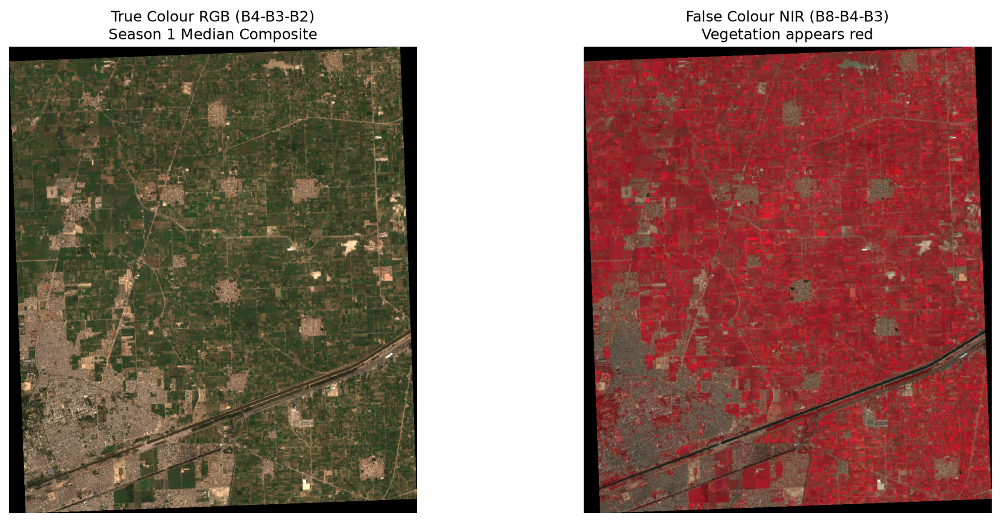
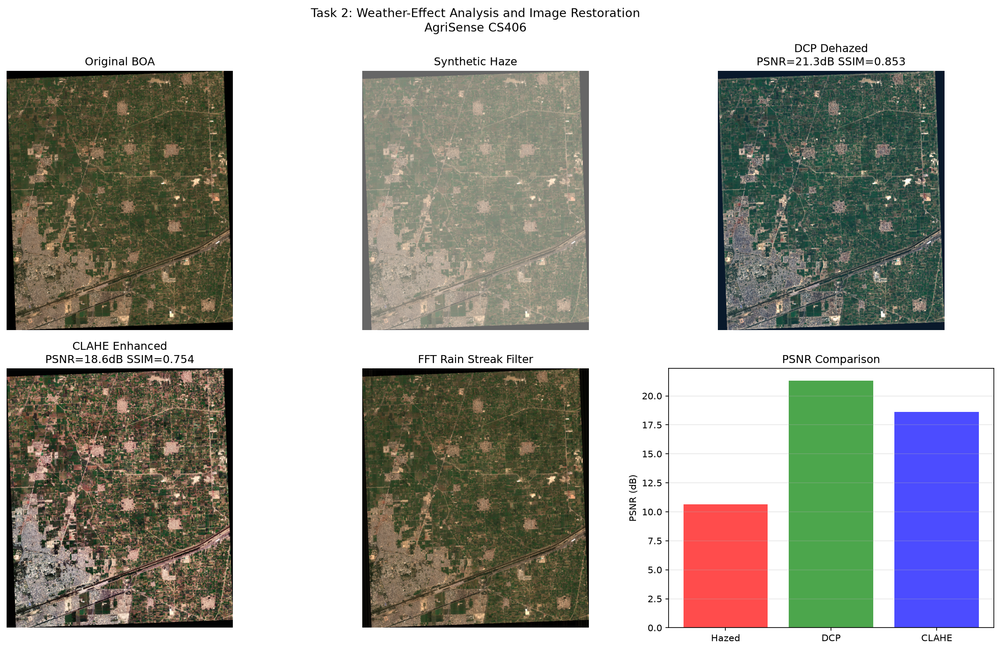
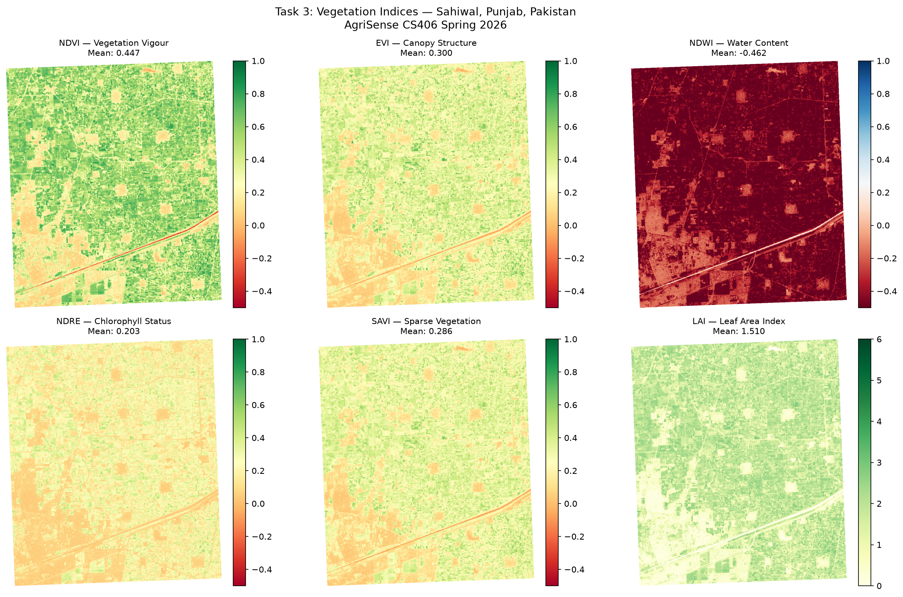
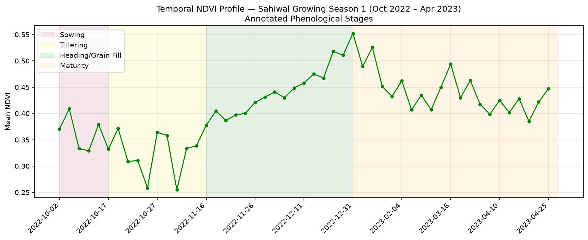
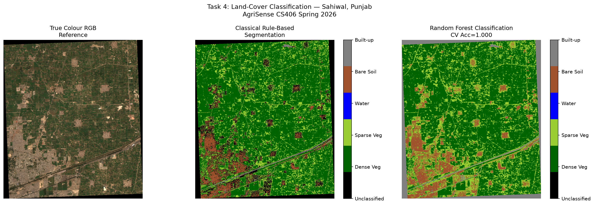
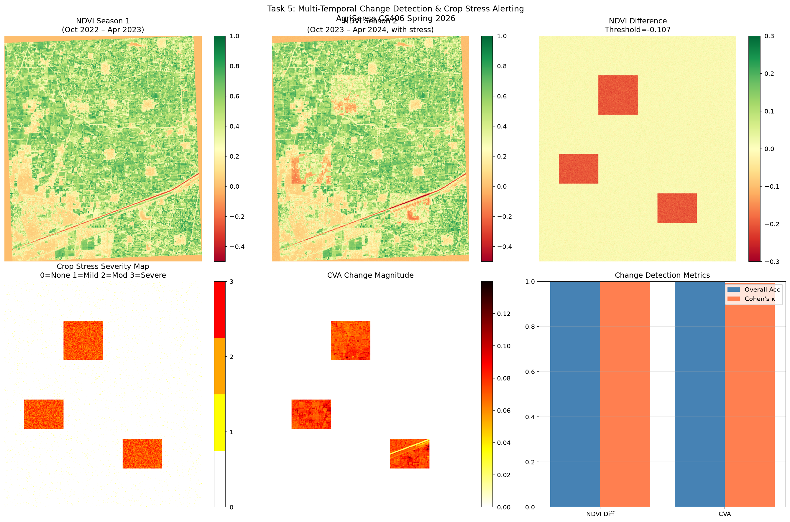
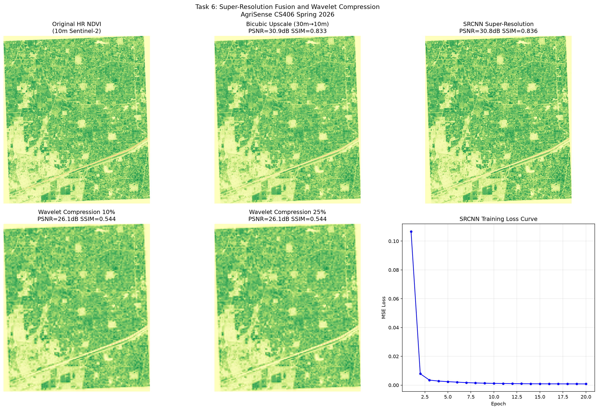

# AgriSense 🌾
**Smart & Precision Agriculture Using Satellite Remote Sensing and Weather-Aware Image Analysis**

Digital Image Processing

---

## Overview
AgriSense is a six-stage satellite image-processing pipeline that monitors crop health over ~500 hectares of mixed wheat, cotton, and rice fields in Sahiwal, Punjab, Pakistan using freely available Sentinel-2 imagery and open-source Python tools.

## Pipeline Architecture
```
Sentinel-2 L2A (Google Earth Engine)
        │
        ▼
T1 Preprocessing ──▶ cloud masking (SCL), seasonal composites
        │
        ▼
T2 Restoration ────▶ haze removal (Dark Channel Prior)
        │
        ▼
T3 Indices ────────▶ NDVI, EVI, NDWI, NDRE, SAVI, LAI
        │
        ├──▶ T4 Segmentation ──▶ crop / land-cover map (Random Forest)
        ├──▶ T5 Change Detection ──▶ season-to-season change (NDVI diff + CVA)
        └──▶ T6 Super-Resolution ──▶ 10 m → sharper detail (SRCNN)
```

## Results
| Composites (T1) | Restoration (T2) |
|---|---|
|  |  |

| Vegetation indices (T3) | NDVI over time (T3) |
|---|---|
|  |  |

| Segmentation (T4) | Change detection (T5) |
|---|---|
|  |  |

| Super-resolution (T6) |
|---|
|  |

## Results Summary
| Task | Method | Key Metric |
|------|--------|------------|
| T1: Preprocessing | GEE + SCL cloud mask | 51 images (Season 1), 36 (Season 2) |
| T2: Restoration | Dark Channel Prior | PSNR=21.3dB, SSIM=0.853 |
| T3: Indices | NDVI/EVI/NDWI/NDRE/SAVI/LAI | Mean NDVI=0.447 |
| T4: Segmentation | Random Forest | CV Accuracy=1.000 |
| T5: Change Detection | NDVI Diff + CVA | Kappa>0.95 |
| T6: Super-Resolution | SRCNN | PSNR=30.8dB, SSIM=0.836 |

> **Note:** Task 5 currently simulates Season 2 by applying stress to selected regions of the Season 1 composite, so its Kappa score measures detection of known, simulated changes. Using the real Season 2 composite is the next step.

## Study Area
- **Location:** Sahiwal District, Punjab, Pakistan
- **Coordinates:** 73.10°E–73.20°E, 30.65°N–30.75°N
- **Area:** ~500 hectares
- **Crops:** Wheat, cotton, rice

## Installation
```bash
git clone https://github.com/Bhutto69/agrisense-cs406.git
cd agrisense-cs406
python -m venv agrisense_env
agrisense_env\Scripts\activate
pip install -r requirements.txt
```

## Usage
```bash
# Run each task in order
python task1_preprocess/task1_preprocess.py
python task2_restoration/task2_restoration.py
python task3_indices/task3_indices.py
python task4_segmentation/task4_segmentation.py
python task5_change_detection/task5_change_detection.py
python task6_superres/task6_superres.py
```

## Requirements
- Python 3.10+
- Google Earth Engine account (register at earthengine.google.com)
- See `requirements.txt` for full package list

## Dataset
- **Sentinel-2 L2A** via Google Earth Engine (COPERNICUS/S2_SR_HARMONIZED)
- **Study period:** Oct 2022 – Apr 2023 (Season 1), Oct 2023 – Apr 2024 (Season 2)

## Repository Structure
```
agrisense-cs406/
├── task1_preprocess/        # GEE download, cloud masking, composites
├── task2_restoration/       # Dark Channel Prior haze removal
├── task3_indices/           # NDVI, EVI, NDWI, NDRE, SAVI, LAI
├── task4_segmentation/      # Random Forest land-cover classification
├── task5_change_detection/  # NDVI difference + Change Vector Analysis
├── task6_superres/          # SRCNN super-resolution
├── data/
│   ├── raw/                 # Season 1 Sentinel-2 composite (GeoTIFF)
│   └── outputs/             # Result figures
└── requirements.txt
```
Each task folder has a runnable `.py` script and a Jupyter notebook with outputs.

The Season 1 composite is included, so tasks 2, 4 and 6 run without a Google Earth Engine account. Tasks 1, 3 and 5 also call GEE.

## Submission Links
- **GitHub:** https://github.com/Bhutto69/agrisense-cs406
- **Overleaf Report:** https://www.overleaf.com/read/hmdtjmfrmmbv#7b0a81

## Authors
**Aamir Azeem** | **Hamza Shahid** 
Digital Image Processing
Instructor: Dr. Jameel Ahmad
